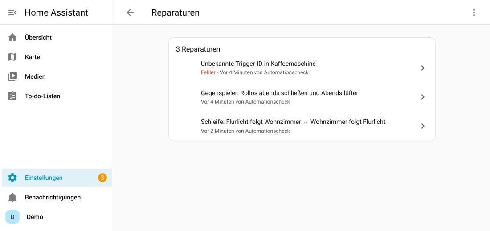
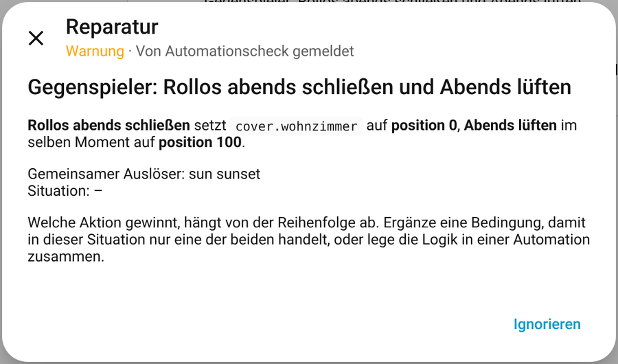

# Automationscheck

Findet in Home Assistant Automationen, die sich **gegenseitig in die Quere kommen** – bevor du dich wunderst, warum das Rollo wieder hochfährt.

Automationscheck liest deine Automationen und Skripte, baut daraus ein Netz aus Auslösern und Aktionen und meldet Auffälligkeiten unter **Einstellungen → Reparaturen**. Es verändert nichts.





<sub>Aufgenommen mit Home Assistant 2026.11 und erfundenen Beispiel-Automationen.</sub>

## Was es findet

| Befund | Beispiel |
|--------|----------|
| **Gegenspieler** | Zwei Automationen reagieren auf denselben Auslöser und stellen dieselbe Entität gleichzeitig unterschiedlich – z. B. eine fährt das Rollo zu, die andere auf. Wer gewinnt, ist Zufall. |
| **Schleife** | Automation A ändert, worauf B lauscht, und B ändert, worauf A lauscht – die beiden schaukeln sich hoch. |
| **Selbstauslösung** | Eine Automation verändert die Entität, auf die sie selbst reagiert. |
| **Unbekannte Trigger-ID** | Eine Bedingung prüft eine Trigger-ID, die es nicht gibt – der Zweig läuft nie. |
| **Auslöser ohne Wirkung** | Ein Auslöser startet die Automation, aber kein Zweig reagiert darauf. |

## Warum es wenig Fehlalarme gibt

Automationscheck rechnet mit Zuständen statt nur Namen zu vergleichen:

- **Bedingungen zählen.** Eine Aktion, die nur bei `haus_modus = Abwesend` läuft, kollidiert nicht mit einer, die nur bei `Zuhause` läuft.
- **Auslöser verraten den Zustand.** Ein Auslöser `to: Zuhause` bedeutet: der Modus *ist* jetzt Zuhause. `from: Kino` bedeutet: er ist jetzt *nicht mehr* Kino.
- **Optionen von Auswahlfeldern werden gelesen.** Ein Sync zwischen Alarmanlage und Hausmodus, der sich nur scheinbar im Kreis dreht, wird als abgesichert erkannt, wenn kein Wert beide Seiten gleichzeitig auslösen kann.
- **Zeit zählt.** Aktionen nach `delay`/`wait` und Auslöser mit unterschiedlichem `for:` gelten nicht als gleichzeitig.
- **Skripte werden mitgedacht.** Was ein aufgerufenes Skript schaltet, zählt für die aufrufende Automation.
- **Blueprints werden aufgelöst** und wie normale Automationen geprüft.

## Installation

Seit Home Assistant 2026.11 ersetzt der eingebaute **Marketplace** HACS. Wer Automationscheck schon über HACS installiert hat, muss nichts tun: Der Marketplace übernimmt es beim Update.

### Über den Marketplace (ab Home Assistant 2026.11)

1. Einstellungen → **Marketplace** → **Über Link hinzufügen**
2. Als GitHub-Link `https://github.com/uekala/automationscheck` eintragen und **Hinzufügen** wählen. Beim ersten Mal fragt der Marketplace nach einer Verbindung zu GitHub.
3. **Automationscheck** öffnen und **Installieren**. Meldet der Marketplace, dass ein Neustart nötig ist, Home Assistant neu starten.
4. Einstellungen → Geräte & Dienste → **Integration hinzufügen** → Automationscheck

### Über HACS (bis Home Assistant 2026.10)

1. HACS → Integrationen → ⋮ → **Benutzerdefinierte Repositories**
2. `https://github.com/uekala/automationscheck` als Kategorie **Integration** hinzufügen
3. **Automationscheck** installieren und Home Assistant neu starten
4. Einstellungen → Geräte & Dienste → **Integration hinzufügen** → Automationscheck

Updates erscheinen danach unter Einstellungen → **Updates**.

## Wann geprüft wird

- nach dem Start von Home Assistant
- wenige Sekunden nachdem du eine Automation oder ein Skript speicherst (Reload)
- zusätzlich alle 6 Stunden
- jederzeit über die Aktion **`automationscheck.run`**, die die Befunde auch als Antwort zurückgibt

## Optionen

| Option | Standard | Bedeutung |
|--------|----------|-----------|
| Auch Hinweise als Reparatur anzeigen | aus | Hinweise sind mögliche, aber nicht sichere Probleme – etwa Schleifen über Werte, die erst zur Laufzeit feststehen. |
| Deaktivierte Automationen mitprüfen | aus | Ausgeschaltete Automationen laufen nicht und können keine Konflikte auslösen. |

## Sensor

`sensor.automationscheck_befunde` zeigt die Zahl der Befunde. Die Attribute enthalten Fehler, Warnungen und Hinweise einzeln, die Anzahl der geprüften Automationen, nicht prüfbare Automationen und die Befunde als Liste – praktisch für eigene Benachrichtigungen oder ein Dashboard.

## Grenzen

- Ziele, die erst zur Laufzeit per Template entstehen (`entity_id: "{{ … }}"`), lassen sich nicht vorhersagen. Ausnahme: `{{ trigger.entity_id }}` wird aufgelöst.
- Ziele über Bereiche, Geräte oder Labels werden noch nicht aufgelöst.
- Template-Bedingungen gelten als „unbekannt“ und schränken daher nichts ein.
- Szenen werden noch nicht berücksichtigt.

Ein Befund ist ein Hinweis zum Prüfen, kein Urteil: Manchmal ist ein Gegenspieler gewollt. Reparaturen lassen sich dann einfach **ignorieren**.

## Entwicklung

```bash
pip install -r requirements_test.txt ruff
ruff check . && ruff format --check .
pytest
```

Die Analyse liegt ohne Home-Assistant-Abhängigkeiten in `custom_components/automationscheck/engine` und lässt sich auch auf einen JSON-Export anwenden:

```bash
cd custom_components/automationscheck
python -m engine.cli export.json --options optionen.json
```

### Release

1. Änderungen im Abschnitt „Unveröffentlicht“ von [`CHANGELOG.md`](CHANGELOG.md) unter einer neuen Versionsüberschrift `## x.y.z – Datum` zusammenfassen.
2. Dieselbe Version in `custom_components/automationscheck/manifest.json` eintragen; `python tools/check_versions.py` prüft, dass beide übereinstimmen.
3. Nach grüner CI auf `main` einen Tag `vx.y.z` und ein GitHub-Release mit dem Changelog-Abschnitt anlegen. Marketplace und HACS bieten das Update danach an. Ein Release, das als Vorabversion markiert ist, sehen dort nur Nutzer, die Vorabversionen eingeschaltet haben.

---

## Lizenz

MIT – siehe [LICENSE](LICENSE).
